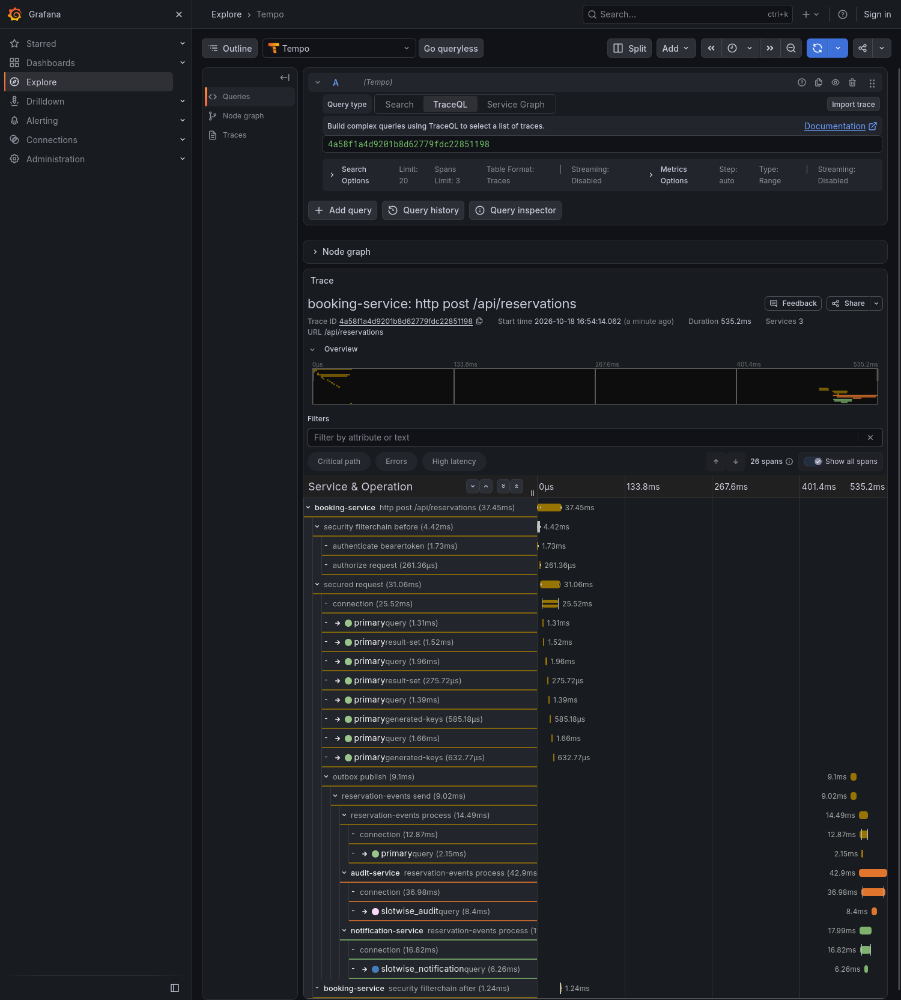
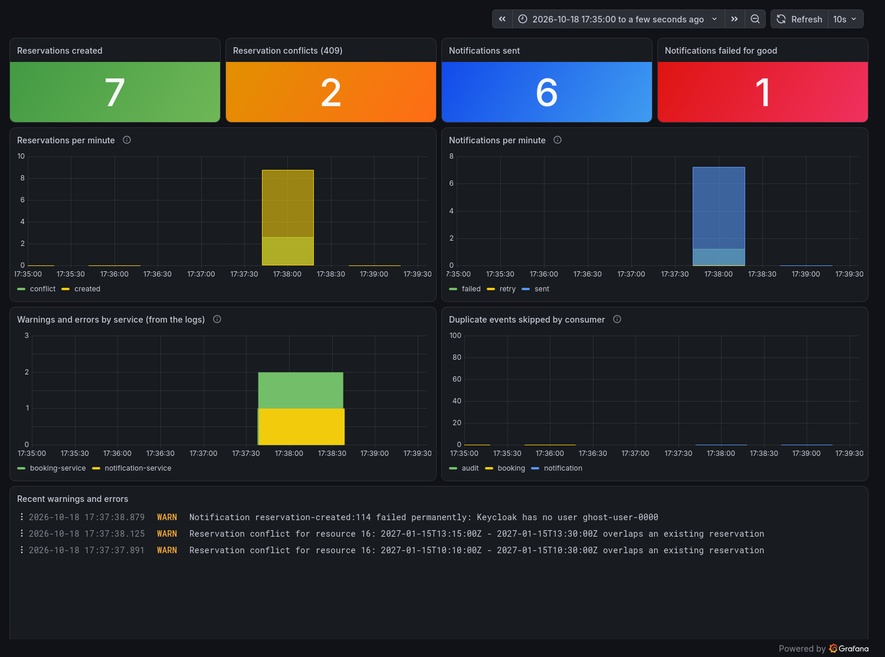
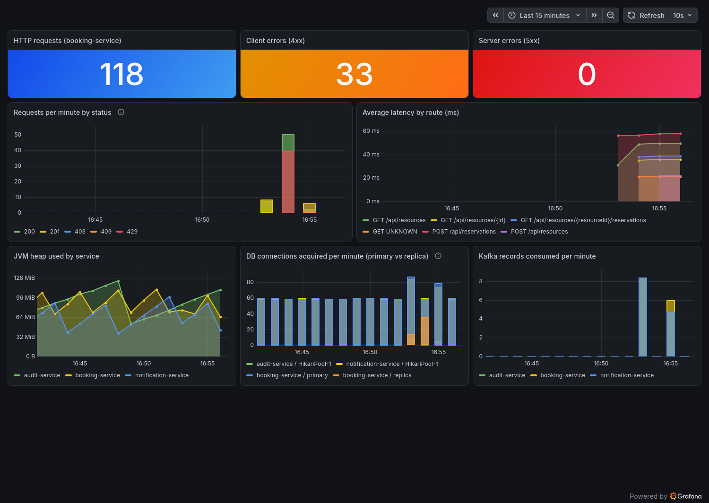
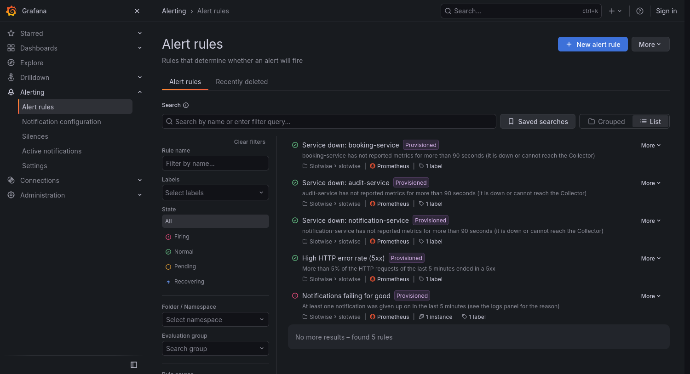

# What we built

Slotwise end to end, with real output from a local run: one request followed through three services, dashboards on counters and
metrics, alerts, and the tests behind it. Everything below comes from the stack in `docker-compose.yml` and the demo traffic
in `scripts/demo-traffic.sh`.

## One request, followed end to end

A `POST /api/reservations` does three things at once in `booking-service`: it saves the reservation, writes an outbox row in
the same transaction, and answers `201`. A relay publishes the row to Kafka a moment later, and `audit-service`,
`notification-service` and `booking-service` itself consume the event, each in its own consumer group.

The trace below is that whole path as OpenTelemetry recorded it (26 spans, 3 services, 535 ms), shown in Grafana Tempo:



- `http post /api/reservations` and the `security filterchain` spans are the request itself.
- The `connection`, `query`, `result-set` and `generated-keys` spans are the JDBC calls (Datasource Micrometer). They are labelled **`primary`**:
  a write goes to the primary pool. A read (`GET /api/resources`) shows the same spans labelled **`replica`**, which is how you see the read/write split.
- `outbox publish` runs **after** the response, on another thread. The trace still continues: the request's
  `traceparent` is stored in the outbox row and restored by the relay (`OutboxTraceContext`).
- `reservation-events send` is the Kafka producer; the three `reservation-events process` spans are the consumers, one per
  service, each with its own insert (into `slotwise`, `slotwise_audit` and `slotwise_notification`). A trace that is complete across the
  outbox is the point of the exercise.

## Business counters, and a dashboard on them

The numbers that matter to the business are counters of our own: `slotwise.reservations{outcome=created|conflict}`, `slotwise.notifications{outcome=sent|retry|failed}` and
`slotwise.events.duplicates{consumer}`. They are Micrometer meters, pushed over OTLP like every other metric and **registered at 0 when the service starts**. The dashboard
reads them from Prometheus (`grafana/dashboards/slotwise.json`); only its two log panels still read the logs, by level and not by message text:



The demo traffic behind these numbers (`scripts/demo-traffic.sh`):

| What was sent | Result | Where it shows up |
|---|---|---|
| 6 reservations by `alice` (admin) | `201` | *Reservations created* |
| 1 reservation naming an owner that does not exist in Keycloak | `201` | created, then the notification **fails for good** |
| 2 reservations overlapping an existing one | `409` | *Reservation conflicts* |
| `bob` (user) creating a resource, and booking for someone else | `403` | not in the dashboard: no event is published |
| the emails of the 6 reservations by `alice` | sent | *Notifications sent* (6) |

!!! note "Why the counters start at 0"

    A counter that only appears when it is first incremented has no earlier sample for Prometheus to compare with, so `increase()` loses that first event. It was
    seen here: a failed notification counted `1` but `increase()` said `0`, and the alert on it did not fire. Each service now registers its counters at start-up
    (`MeterBinder`), which fixed both. See [Decisions](decisions.md#business-counters-alerts-and-actuator-fase-4).

## Real application metrics

The dashboard above shows counters of our own. This one shows what Micrometer measures **by itself**: its meters (HTTP server, JVM, Hikari, Kafka client)
pushed over OTLP to the Collector and stored in Prometheus (`grafana/dashboards/slotwise-metrics.json`):



- **Requests per minute by status**: `201` created, `409` conflict, `403` forbidden. The red `429` bar is the rate limiter (a Redisson token bucket): the
  demo fired a burst of reads and the app answered `429 Too Many Requests` to the excess.
- **DB connections acquired per minute**: the constant ~60 per minute on `primary` is the `OutboxRelay` polling the outbox table every second;
  the orange bars are reads served by the `replica`.
- **Average latency by route**, **JVM heap by service** and **Kafka records consumed** come from the same pipeline, with no code of ours behind them.

## Alerts

Five alert rules are provisioned in Grafana from `grafana/provisioning/alerting/slotwise-alerts.yaml`: one **service down** rule per service (no metrics for 90 s, which also fires if the
Collector is unreachable), the **5xx error rate** above 5 %, and **notifications failing for good** (a business counter). The screenshot was taken while that last one was firing,
after the demo traffic gave a notification an owner that does not exist in Keycloak:



Both kinds were tried for real: stopping `notification-service` turned its *service down* rule to firing about two and a half minutes later (and back to normal when it came back), and the
failed notification fired its rule within a minute. They only change state: no contact point is configured, so nothing is sent anywhere yet.

## Searching the logs

Every log line carries the `trace_id` and `span_id` of the request, and the logs are ECS JSON on the console. In Grafana's
*Explore* the same lines can be filtered by service and level:


## What the API answers

Real responses from the same run:

```text
POST /api/resources        (alice)  ->  201  {"id":4,"name":"Meeting room Barcelona","description":null,"active":true}
POST /api/reservations     (alice)  ->  201  {"id":15,"resourceId":4,"startTime":"...T09:00:00Z","endTime":"...T09:50:00Z",
                                              "ownerSubject":"<alice's token sub>","status":"CONFIRMED"}
POST /api/reservations     (overlap) -> 409  {"message":"Resource 4 already has an overlapping reservation for that time range"}
POST /api/resources        (bob)    ->  403
POST /api/reservations     (bob, owner = someone else)
                                    ->  403  {"message":"User <bob's sub> cannot book on behalf of someone-else (admin only)"}
```

```text
GET  /actuator/health      (no token) ->  200  {"groups":["liveness","readiness"],"status":"UP"}
GET  /actuator/info        (no token) ->  200  {"app":{"name":"booking-service"}}
GET  /actuator/env         (no token) ->  401
```

Only `health` and `info` are public (the probes Kubernetes will want, and the service name); the rest of Actuator is not even exposed.

The `409` is the `reservations_no_overlap` constraint plus a `SELECT ... FOR UPDATE` on the resource row (see Fase 2 in the
[roadmap](roadmap.md)); the `403`s come from Keycloak roles mapped to Spring Security authorities.

## The tests behind it

The last full `mvn test` run, on Spring Boot 4.1.1: **69 tests, all passing**, against real Testcontainers (Postgres, Redis, Kafka) rather than mocks.

| Module | Tests | What stands out |
|---|---|---|
| `booking-service` | 27 | two concurrent overlapping reservations: only one wins; the request's trace survives the outbox and Kafka (`create_continuesTheRequestTraceThroughOutboxAndKafka`); a poison message does not block the consumer; Redis write-through is immediate; the reservation counters count only what committed; `health`/`info` are public and `env` is not |
| `audit-service` | 14 | a duplicate event is stored once; a poison message lands on the dead-letter topic with its original bytes |
| `notification-service` | 20 | the inbox worker's retries, the Keycloak client, idempotent listener |
| `slotwise-kafka-support` | 1 | a record that always fails is retried, then dead-lettered to `reservation-events.DLT` (and it proves the auto-configuration activates itself) |
| `slotwise-observability` | 7 | the default properties are added with the lowest priority (and one variable, `COLLECTOR_URL`, moves the three telemetry endpoints); the business counters exist at 0 from start-up; the Grafana dashboards and alert rules only mention series and tag values that the code can really emit |

## Reproduce it

```bash
docker compose up -d                       # Postgres, Redis, Kafka, Keycloak, OTel Collector, Grafana
mvn -DskipTests install
mvn -pl booking-service spring-boot:run    # and audit-service, notification-service in two more terminals
scripts/demo-traffic.sh                    # then open http://localhost:3000 (Dashboards, Explore)
```

!!! note "How these screenshots were taken"

    Grafana was driven by a headless Firefox through Marionette (its automation socket), waiting for the panels to render
    before capturing. They are a snapshot of one local run (the demo traffic from `scripts/demo-traffic.sh` plus a burst of reads), not generated by CI.
